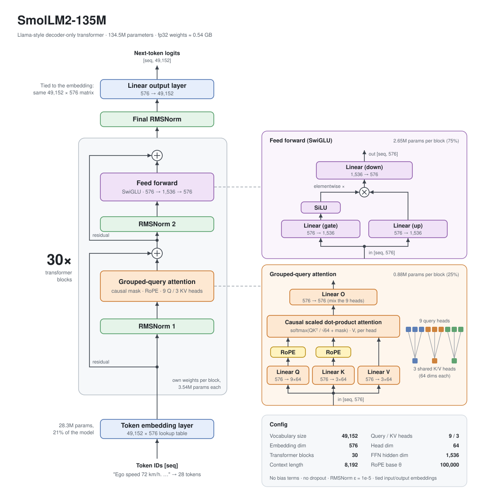

# SmolLM2-135M architecture

Numbers come from the model's `config.json` and parameter shapes under transformers 5.22.2. Data
flows bottom to top; `seq` is the number of tokens.

## What the elements do

**Token IDs.** The tokenizer (byte-level BPE) maps text to IDs from a 49,152-entry vocabulary.
Digits are one token each, so the model sees `72` as `7`, `2`.

**Token embedding layer.** A lookup table: row *i* is the 576-dim vector for token *i*. No
position information is added here; that comes from RoPE inside attention.

**Transformer block (30×).** Thirty blocks with the same structure and their own weights. Each one
reads every token's running 576-dim vector (the *residual stream*), computes an update, and adds
it back.

**RMSNorm.** Rescales each vector to unit root-mean-square, then multiplies by a learned gain per
dimension. Like LayerNorm, but without mean subtraction or bias. It sits *before* each sub-layer
(pre-norm), which keeps a deep stack stable to train.

**Grouped-query attention.** The only place tokens exchange information. Each token's query is
scored against the keys of itself and all earlier tokens; the softmax of those scores weights a
sum of their values. The causal mask hides later tokens, which is what makes this a next-token
predictor. 9 heads of 64 dims run in parallel, and Linear O mixes them back into 576.

- *Grouped-query:* only 3 key/value heads, each shared by 3 query heads. The K/V projections and
  the KV cache are 3× smaller than with 9 full heads.
- *RoPE (rotary position embedding):* rotates queries and keys by angles proportional to token
  position, so the score between two tokens depends on their distance. θ = 100,000 is the base
  of the rotation frequencies.

**Residual add (+).** Adds a sub-layer's output to its input. Information and gradients can pass
any block unchanged; each sub-layer only writes a correction.

**Feed forward (SwiGLU).** A per-token MLP; nothing moves between tokens here. Two parallel
projections go up to 1,536 dims, one passes through SiLU and gates the other by elementwise
multiplication, and Linear (down) projects back to 576. This is where most parameters live.

**Final RMSNorm.** Normalizes the residual stream once more before the output layer.

**Linear output layer (LM head).** Turns each 576-dim vector into 49,152 logits, one score per
vocabulary token; softmax over them gives the next-token distribution. It reuses the embedding
matrix (*weight tying*), which saves 28.3M parameters.

## Where the parameters are

| Component | Weight shapes | Parameters | Share |
| --- | --- | ---: | ---: |
| Token embedding (shared with output layer) | 49,152 × 576 | 28,311,552 | 21.0 % |
| Attention, 30 × Q, K, V, O | 576×576, 192×576, 192×576, 576×576 | 26,542,080 | 19.7 % |
| Feed forward, 30 × gate, up, down | 1,536×576, 1,536×576, 576×1,536 | 79,626,240 | 59.2 % |
| RMSNorm gains, 61 × | 576 | 35,136 | < 0.1 % |
| **Total** | | **134,515,008** | |

At fp32 (4 bytes per parameter) the weights take about 0.54 GB.

## Compared with GPT-2

GPT-2 used LayerNorm, learned absolute position embeddings, a GELU MLP and full multi-head
attention. SmolLM2 swaps in RMSNorm, RoPE, SwiGLU and grouped-query attention: the standard
Llama recipe that most current open models share.

## In the code

`.venv/lib/python3.12/site-packages/transformers/models/llama/modeling_llama.py`:
`LlamaRMSNorm`, `LlamaRotaryEmbedding` and `apply_rotary_pos_emb`, `LlamaAttention` and
`repeat_kv` (the K/V head sharing), `LlamaMLP` (SwiGLU), `LlamaDecoderLayer` (one block), and
`LlamaForCausalLM` (embedding, blocks, final norm, output layer). M1's `00_inspect_model.py`
checks this breakdown against the live model.
